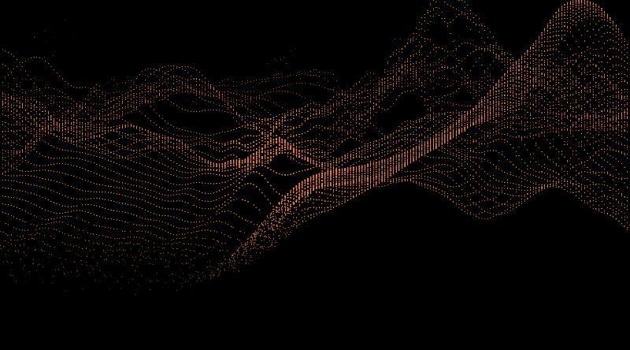

# wave-header

An interactive dotted-wave header for websites, rendered with WebGL. No dependencies, no build step.



- **Organic terrain.** Noise-driven hills with uneven crests and troughs that roll toward the viewer and slowly morph. A new landscape is generated on every page load.
- **3D cursor interaction.** Move the cursor over the dots and they rise, with the height tapering off around the cursor. The bump is treated as a point in 3D space: near the top of the wave (far away) it is small and subtle, near the bottom (close to you) it is wide and tall. A short trail makes dots rise and settle in a staggered way.
- **Depth gradient.** Dots shade from deep red-orange in the distance to bright orange up close, with crests and steep faces glowing hotter.
- **Scattered edges.** The wave dissolves into loose, scattered dots toward its far and near edges instead of ending in clean rows.
- **Well-behaved.** Pauses when off-screen or in a hidden tab, respects `prefers-reduced-motion`, handles high-DPI screens and resizes.

## Quick start

`index.html` is a **single self-contained file** (CSS and JS inlined), so you can open it directly or upload it on its own to any host.

To serve the folder locally instead:

```bash
python3 -m http.server 8000
```

Then visit <http://localhost:8000>.

## Use it on your site

Copy `src/wave-header.css` and `src/wave-header.js` into your project.

```html
<link rel="stylesheet" href="wave-header.css">

<header data-wave-header>
  <!-- optional: your own content, it sits above the waves -->
</header>

<script src="wave-header.js"></script>
```

Or initialise it from JavaScript:

```js
const header = WaveHeader.init(document.querySelector('header'), {
  speed: 0.2,
  ramp: [[0.3, 0.05, 0], [0.8, 0.2, 0], [1, 0.4, 0], [1, 0.5, 0.1]],
});

header.destroy(); // remove the canvas, listeners and WebGL context
```

You can also pass options in markup: `<header data-wave-header data-wave-options='{"speed": 0.2}'>`.

### Sizing and background

The header height and background are CSS variables:

```css
.wave-header {
  --wave-header-height: 70vh;   /* default: clamp(520px, 85vh, 1000px) */
  --wave-header-bg: #000;
}
```

The wave is drawn on a transparent canvas, so it works over any dark background.

## Options

All options are optional. Defaults live in `WaveHeader.defaults`.

| Option | Default | Description |
| --- | --- | --- |
| `spacing` | `6.5` | CSS px between dots on screen |
| `stagger` | `0.5` | Shifts every other row sideways by this fraction of a dot spacing (`0` = straight columns) |
| `staggerY` | `0.5` | Shifts every other column up/down by this fraction of a row spacing (`0` = straight rows) |
| `jitter` | `0.25` | Random sideways offset per dot, as a fraction of the spacing (`0` = perfect lattice) |
| `jitterY` | `0.15` | Random up/down offset per dot, as a fraction of the row spacing |
| `scatter` | `1.0` | How loosely dots break up toward the wave's edges |
| `speed` | `0.375` | How fast the terrain morphs |
| `drift` | `1.0` | How fast the terrain rolls toward the viewer (world units / second) |
| `swell` | `0.55` | Strength of the travelling swells on top of the terrain (`0` = off) |
| `swellSpeed` | `0.55` | How fast those swells travel |
| `height` | `7.0` | Overall wave height |
| `scale` | `0.032` | Base noise frequency; smaller values give broader hills |
| `radius` | `70` | Reach of the cursor in CSS px, at mid-depth |
| `lift` | `0.036` | Peak rise under the cursor, as a fraction of the canvas width |
| `trailLife` | `0.42` | Seconds a cursor position keeps influencing the dots (shorter = smaller area) |
| `trailStep` | `0.025` | Seconds between trail samples |
| `ramp` | orange | Four RGB stops (0–1), from dark/far to bright/near |
| `horizon`, `nearEdge`, `focal`, `cameraHeight`, `zFar` | | Camera and framing |

## Development

The source of truth is `src/wave-header.js` and `src/wave-header.css`. After editing them, regenerate the standalone `index.html` (needs Python 3):

```bash
./build.sh
```

## Browser support

Any browser with WebGL 1 (all current desktop and mobile browsers). Without WebGL, the header simply shows its plain background.

## Deploying with GitHub Pages

The demo is plain static files. In your repository go to **Settings → Pages**, choose the `main` branch and the root folder, and it will be live at `https://<user>.github.io/<repo>/`.

## Third-party

The terrain uses 3D simplex noise from [webgl-noise](https://github.com/ashima/webgl-noise):

> Copyright (C) 2011 Ashima Arts. All rights reserved.
> Author: Ian McEwan, Ashima Arts. Distributed under the MIT License.

Your own code in this repository still needs a license; add a `LICENSE` file of your choice.
